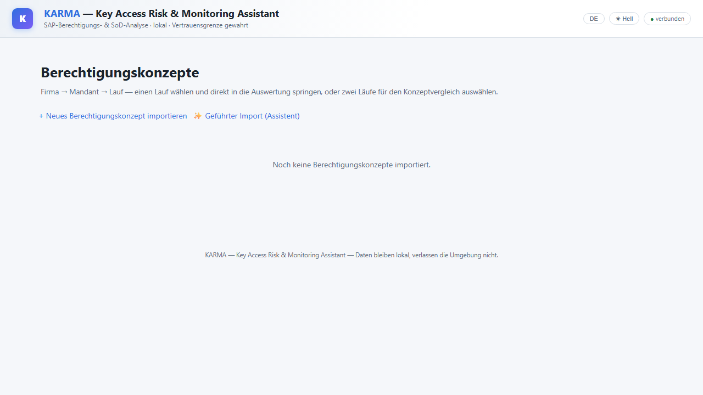

# Installation

This guide takes you from an empty Windows machine to the running app and the first import. There are **two
ways**; which one fits depends on whether Docker Desktop is allowed on the machine.

## Which Variant Fits?

| | **A · Docker** (standard) | **B · Native Windows installation** (without Docker) |
| --- | --- | --- |
| **For whom** | Your own computer or laptop where Docker Desktop may be installed | Company machines ("third-party machines") where Docker is not possible |
| **What runs how** | Neo4j and backend as containers | Neo4j as a Windows service, backend as a scheduled task, both start with the machine |
| **Installation** | Commands in PowerShell | **Double-click `install.exe`** — no PowerShell needed |
| **Updates** | `git pull` in the project folder | automatically every day, or by a click in the "IAM verwalten" window |
| **Administration** | `docker compose` | "IAM verwalten" window (desktop shortcut) |

Both variants deliver the same app at <http://localhost:8000/>. What takes effect when after an update is
explained under [Updates: What Needs a Restart?](updates.md).

## Common Prerequisites

- **Windows 10 or 11, 64-bit.**
- **Enough memory.** Neo4j keeps the graph data in memory; large SAP extracts need a lot. The Docker setup
  reserves 8 GB heap and 4 GB page cache by default, the native installation 16 GB heap and 8 GB page cache
  (designed for a machine with 32 GB RAM). On smaller machines, lower the values (see below).
- **Access to the repository.** The repository is private. The credentials or the deploy key come from the
  operator.
- **Internet access during the first installation** (program packages and Neo4j are downloaded).
- **No OneDrive folder as the target.** The installation folder contains SAP extracts and backups, i.e. client
  data that must not leave the machine — a synchronized folder would upload them to the cloud.

---

## Variant A · Docker

**Additionally required:** [Docker Desktop](https://www.docker.com/products/docker-desktop/) with the **WSL2
backend**, and Git.

1. **Clone the repository** and change into the folder (PowerShell):

   ```powershell
   git clone https://github.com/neoprehn/iam.git
   cd iam
   ```

2. **Create the credentials.** Copy the template and set the Neo4j password (at least 8 characters). The
   `.env` file stays local and is never checked into the repository.

   ```powershell
   Copy-Item .env.example .env
   notepad .env
   ```

   The file also contains `IMPORT_LANG`, the language for text tables during import (default German).

3. **Start.** The first start pulls the images, installs APOC and builds the backend — this takes a few
   minutes.

   ```powershell
   docker compose up -d --build
   docker compose run --rm migrations
   ```

   The second command creates the database schema once (it is repeatable; the first import also ensures it).

4. **Check.** The app runs at <http://localhost:8000/>, the Neo4j browser at <http://localhost:7474/>.

   ```powershell
   docker compose ps          # both containers should show "running" or "healthy"
   docker compose logs backend --tail 50
   ```

---

## Variant B · Native Windows Installation (Without Docker)

This variant is meant for machines where nobody should set up a development environment. **`install.exe`**
does everything that is needed.

### 1 · Provide the package

The operator sends a **folder (usually as a ZIP)** containing `install.exe`, `manage.exe` and the associated
PowerShell scripts. Unpack it to a **permanent local location** (e.g. `C:\iam-setup`, **not** under OneDrive
and not in "Downloads") — the update task and the management window call the files from this folder later.

### 2 · Place the access key next to `install.exe`

The program code is loaded from the private repository via SSH. The **deploy key** (file `iam-deploy-key`) comes
from the operator **separately from the package** — for security reasons not inside the ZIP. Put the file **into
the unpacked folder, right next to `install.exe`**, **before** you start the installation.

At startup `install.exe` checks whether the key is there (or in `%USERPROFILE%\.ssh\`) and takes it over into a
protected folder (`C:\ProgramData\iam\ssh`) that the update task can also use. Confirming the GitHub connection
manually (`ssh -T …`) is **no longer** needed. If the key is missing during the first installation, the
installation stops immediately with a clear message.

- **Update by starting `install.exe` again:** the key does not have to be there again if it is already set up;
  otherwise a warning appears.
- **Afterwards:** the key file in the package folder can be deleted; the installation keeps a protected copy.

### 3 · Start `install.exe`

**Double-click `install.exe`.** Windows asks for administrator rights via the security prompt (UAC) — confirm.
A right-click "Run as administrator" or an open PowerShell is **not** needed.

### 4 · Choose the target folder

A **folder selection dialog** opens. The app is created in a subfolder `iam` of the chosen folder; on "Cancel"
the default `C:\iam` applies.

:::{admonition} Important: not under OneDrive
:class: warning
If the chosen path is recognizably under OneDrive, the installation asks explicitly. The default is **"No"** —
please keep it and choose a simple local path such as `C:\iam` or `D:\iam`. The installation folder will later
contain SAP extracts and backups.
:::

### 5 · The installation runs

A console window shows the progress in **eight steps**:

| Step | What happens |
| --- | --- |
| 1 · Prerequisites | Git and Python are looked for; if missing, `winget` installs Git or Python 3.12. Java 17 or newer is checked; if the existing Java is too old, it stays unchanged for other programs and Neo4j uses an additionally installed Java 21. |
| 2 · Repository | The program code is loaded into the target folder (only the parts needed for operation). |
| 3 · `.env` | A credentials file with a **randomly generated** Neo4j password is created. |
| 4 · Python | A dedicated Python environment with the required packages is created. |
| 5 · Neo4j | Neo4j Community is downloaded, configured (memory, APOC) and started as a **Windows service**. The first start can take a minute. |
| 6 · Backend | The backend is set up as a scheduled task; it starts with every system start, even without a login. |
| 7 · Update task | A daily task at 06:00 fetches new program code and restarts the backend. |
| 8 · Management window | A desktop shortcut **"Manage IAM"** is created. |

At the end the window stays **open** and waits for Enter — success and error messages remain readable. The
installation is **repeatable**: after an error, simply start it again; steps already done are skipped.

### 6 · Check

After the installation, the following are reachable:

- the **app**: <http://localhost:8000/>
- the **Neo4j browser**: <http://localhost:7474/>

Via the desktop shortcut **"IAM verwalten"** (a window with Start, Stop, "Neu starten" = restart, "Jetzt
aktualisieren" = update now, "Web-App öffnen" = open web app, and the logs) you can check the state at any time.

### 7 · Verify once

Neo4j reads the rule sets through a fixed path that the installation provides via a directory junction. This
is the only non-obvious assumption of this setup — right after the installation, please click **"Verifizieren
(Rulesets)"** (verify rulesets) in the **"IAM verwalten"** window (or run the command from the "Verify" section of the
[Windows page](../technik/windows-native.md)) **before** loading a rule set or starting a run.

### Little memory?

The defaults (16 GB heap, 8 GB page cache) are designed for a machine with 32 GB RAM. On smaller or heavily
loaded machines, lower the values in the "IAM verwalten" window via **"Speicher setzen + Neo4j neu starten"** (set memory + restart Neo4j) — or start the
installation with your own values (PowerShell as administrator, in the package folder):
`.\install.ps1 -HeapSizeGb 4 -PageCacheGb 4`. Calling it again **without** parameters changes nothing on an
existing installation.

:::{note}
The "IAM verwalten" window ("Manage IAM") and the installer console are in German; the German button names
are given in quotation marks.
:::

---

## After the Installation: First Steps

:::{note}
The screenshots show the German user interface (the language can be switched in the app).
:::

### Start page

The start page at <http://localhost:8000/> does not show any authorization concepts yet. The first import
starts from here.



*Start page of a freshly installed app. The screenshots on this page show sample data.*

### Provide data

The app evaluates **SAP extracts** (SE16 downloads). Which tables with which fields are needed and how to
produce them is described in the [Extraction Guide](../extraktionsleitfaden.md). The files stay local and never
leave the machine.

### Import

There are two entry points: **"✨ Guided import (assistant)"** leads step by step through the whole evaluation
and begins with the import; **"+ Import new authorization concept"** opens the import form directly.


*The assistant begins with the import. "Start import" opens the form.*

In the import form:


- **Dataset name** — a **required field**. The name determines which authorization concept is imported into;
  an already existing name would import into that concept instead of creating a new one (the app asks
  explicitly in this case).
- **ZIP file** or **folder** with the `.txt`/`.csv` files of the SAP extracts.
- **As-of date** — the download date of the extracts. If left empty, it is derived from the file timestamps; a
  later correction is possible.
- **Languages** — default `DE,DEU,D` for German texts.

After the import and the first evaluation, the concept appears as a card on the start page — with as-of date,
number of findings and rules. **"Open"** leads from there into the evaluation.


*Example card of a dataset with one run.*

How to continue (starting an evaluation, reading results, consistency checks, backups) is described in the
[Workflow](workflow.md); the individual functions are explained in the [Function Reference](funktionen.md).

---

## If Something Does Not Work

| Symptom | What to check |
| --- | --- |
| The page at `localhost:8000` does not load | **Docker:** `docker compose ps` — is the backend running? Log: `docker compose logs backend`. **Native:** look at the status in the "IAM verwalten" window; if it says "Backend: NICHT aktiv" (not active), click **"Start"** and look for the cause with **"Backend-Log anzeigen"** (show backend log). |
| The backend does not start and reports an import error | A Python package or a file is missing, usually after an update. **Docker:** `docker compose up -d --build`. **Native:** "Jetzt aktualisieren" (update now, see [Updates](updates.md)). |
| Neo4j does not start or does not respond | **Docker:** `docker compose logs neo4j`. **Native:** "Neo4j-Log anzeigen" (show Neo4j log) in the management window; on the very first start the service can take up to a minute. |
| Import aborts with a memory error (`OutOfMemory`) | Give Neo4j more memory (Docker: values in `docker-compose.yml`; native: "Speicher setzen + Neo4j neu starten"). The import can be resumed. |
| Native installation: "access key not found" or "Host key verification failed" | Put the file `iam-deploy-key` **next to `install.exe`** (alternatively into `%USERPROFILE%\.ssh\`) and start `install.exe` again. |
| Error when changing or loading a rule set | Run the "Verify" step (above). |

More details, uninstallation and administration of the Windows installation:
[Native Windows installation](../technik/windows-native.md).
