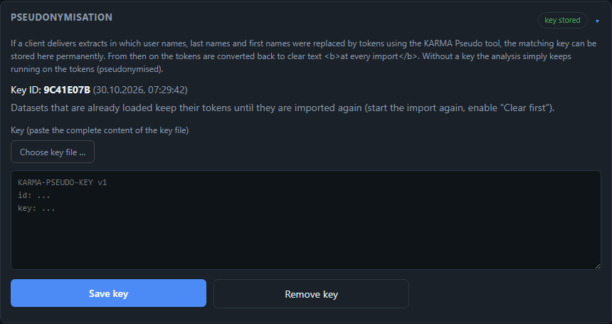

# Pseudonymisation of Personal Data

Some clients only release extracts if **user names, last names and first names** are not included in clear text. The same applies to test data.
For this there is the standalone tool **KARMA Pseudo** (folder `pseudo/` in the repository). It replaces the personal columns with tokens and runs
entirely locally without network access, so it can be handed to the client. KARMA itself converts the tokens back as soon as the matching key is
stored.

## Process at a Glance

1. **Create a key** (once per client) — in KARMA Pseudo choose *Neu erzeugen …* ("create new"). The result is a small `….key` file.
2. **Pseudonymise the extracts** — choose the input (folder, KAAP package as ZIP or a single file) and an output folder, check the **preview**,
   then **Pseudonymisieren**. Result: `pseudonymisiert-<date>.zip` and a check report.
3. **Hand it over** — only the ZIP goes to the recipient. The key file stays with the client or is handed over **separately**, through
   another channel. The check report is for the creator only.
4. **Import** — import the ZIP into KARMA like any other extract. Without a key KARMA works with the tokens (pseudonymised).
5. **Store the key** (optional, permanent) — *Management → Configuration → Pseudonymisation*. From the next import on, the tokens are
   converted back to clear text.

*The paths in the picture are examples. The tool is available in German only.*

## What Is Replaced

| Class | Columns (examples) | Token starts with |
|---|---|---|
| User name | `BNAME`, `UNAME`, `CREATE_USR`, `CHANGE_USR`, `USERNAME`, `MODBE`, `ANAME`, `REFUSER`, `USERALIAS` | `ZU` |
| Name / first name | `NAME_LAST`, `NAME_FIRST`, `NAME_TEXT`, `MC_NAMELAS`, `MC_NAMEFIR` | `ZN` |
| Person number (optional) | `PERSNUMBER` | `ZP` |

- The relation between the files is **preserved**: the same user name yields the same token in `USR02`, `AGR_USERS`, `UST04` and so on.
  Upper/lower case and surrounding blanks do not matter for user names.
- **Standard users stay in clear text** (`DDIC`, `SAP*`, `TMSADM`, `EARLYWATCH` …), because rules and evaluations recognise technical users by
  name. The list can be changed in the window.
- The person number is only replaced on request (checkbox in the window); it is an internal number, but it links `V_USERNAME` and `ADRP`.
- More columns can be added in the `$ColClass` table at the top of `karma-pseudo.ps1`. The **preview** shows per file which columns were detected.

Inputs: SE16 list export (`.txt`), CSV/TSV and KAAP extractor packages (ZIP with an inner ZIP per table; the structure is preserved).
Files that are not data tables (logs, images, XML from the extractor) are not taken over.

## The Token

`ZU` + Base32 of tag and ciphertext, only upper-case letters and the digits 2–7, e.g. `ZUBCYA5IM5RWABSVFW3HE64` for a 7-character user name.
A typical user name yields 25–31 characters; names are somewhat longer according to their length. Method "KP1": an HMAC-SHA256 tag (6 bytes) over
class and clear text, plus AES-256-CTR with the tag as nonce. It is **deterministic** (required to preserve the relation) and **reversible** with
the key; the tag doubles as an authenticity check. It is deliberately not encryption for the highest demands: equal values are recognisable
as equal (frequencies), and the length of the clear text can be read off.

## Check Report and Limits

The check report (`pruefbericht-<date>.txt`, **not** in the ZIP) lists the detected columns and counts per file. It also searches all other columns
for **clear-text hits**: if a user name or name appears as a word in a role name or text (e.g. `Z_HR_MUELLER`), the column is reported with row
numbers — without naming the values. These columns are **not** changed automatically; check the hits before handing over (a hit can also be a
harmless word).

Not covered are free text and company or client names (e.g. the client's text in `T000`). Anyone who has to hide these as well replaces
them by hand beforehand.

## Storing the Key in KARMA

*Management → Configuration → Pseudonymisation*: choose the key file (or paste its content) and click **Save key**. KARMA afterwards shows only the
**key ID**, never the key itself. It is stored in `config/pseudo.key` (excluded from the repository by `.gitignore`).

- **At import** KARMA replaces the tokens in the converted `.csv` files with clear text (step "Decrypt pseudonyms"); this also applies to
  `.csv` files delivered directly. Files without tokens are left untouched; the step can be repeated.
- **Datasets that are already loaded** keep their tokens until they are imported again (enable *Clear first*). The graph is deliberately not
  rewritten afterwards, because user names are part of the node keys.
- **Replacing the key**: only after confirmation; data pseudonymised with the previous key can no longer be decrypted afterwards. **Removing the
  key**: new imports stay pseudonymised, data already decrypted in the graph remains.
- After saving, **delete** the key file (Downloads folder, recycle bin, hand-over media). KARMA points this out.
- A **lost key** cannot be replaced: the pseudonyms can then no longer be converted back. Protect the key like a password.
- Single tokens can be resolved with *Token nachschlagen …* ("look up token") in the tool (command line: `-Action lookup`).

From the moment a key is stored, KARMA holds clear text in the graph. For clients who do not want that, operation without a key remains fully
usable — the evaluations then show the tokens instead of the names.
