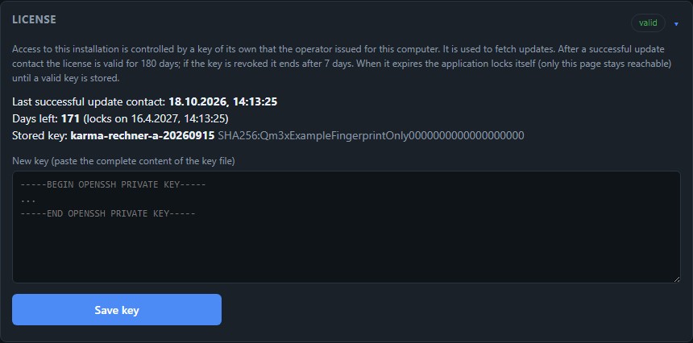
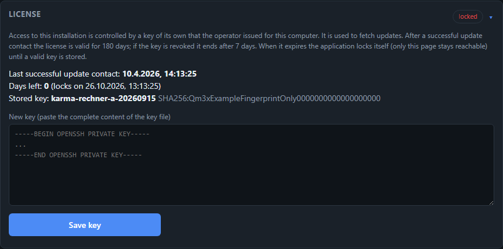
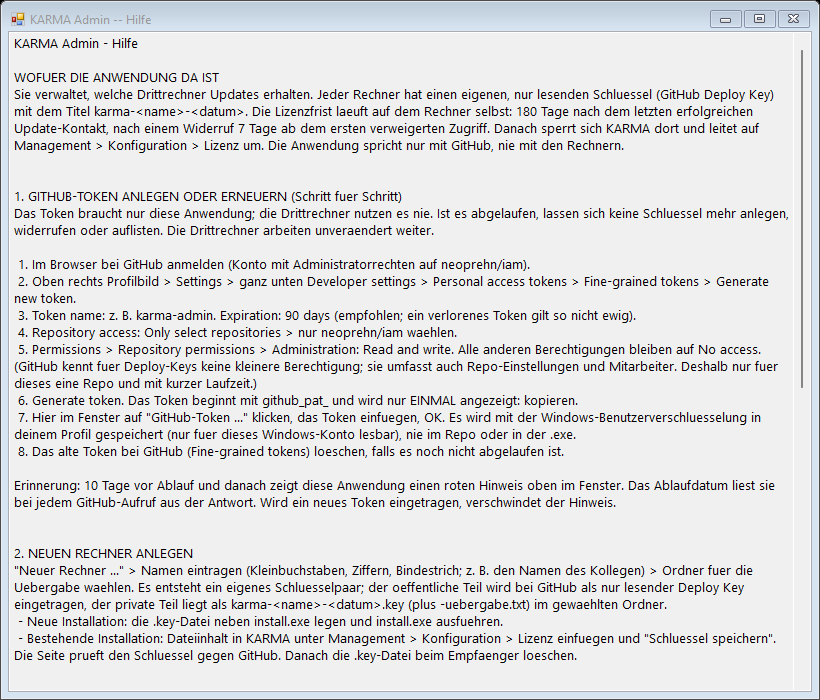

# Native Windows Installation (without Docker)

The standard path is **container-only** via Docker Desktop/WSL2 (see [Architecture](architektur.md)
and the main `README.md`). For exactly one case, there is a deliberate, additional departure from
this: a third-party machine on which Docker Desktop must not or cannot be installed, but the
individual components (Python, Java, Neo4j) can be. Scripts, the full guide, and troubleshooting
live in the repo under [`deploy/windows-native/`][repo-deploy] — this page describes the purpose,
procedure, and the trust boundary for it.

[repo-deploy]: https://github.com/neoprehn/iam/tree/main/deploy/windows-native

## What Is Created

- **Neo4j Community Server** as a native Windows service (no container) — memory/APOC/import
  settings are taken 1:1 from `docker-compose.yml`, so that the Docker and native installation
  behave functionally identically.
- **Backend** (`uvicorn`) as a scheduled task that runs automatically on every system start, even
  without a login — functionally the Windows equivalent of the `iam-backend` container.
- A **daily update task**: `git fetch` + `merge --ff-only`, synchronize Python dependencies,
  restart the backend. Deliberately a simple pull instead of a real CI/CD build server — no
  additional operational overhead, code comes unmodified from the git repo. It aborts (instead of
  overwriting) if the local state cannot be updated via fast-forward.
- A small **management window** ("Manage IAM", desktop shortcut) for start/stop/restart, "update
  now", opening the web app, viewing the update/Neo4j log, and a verify click — without having to
  operate PowerShell.
- Both entry points (installer, management window) are also available as standalone `.exe` files
  (`ps2exe`, `-requireAdmin` manifest) — no manual PowerShell window, no file-association
  pitfalls on double-click.

The package (`install.ps1`, `manage.ps1`, `update.ps1`, `start-backend.ps1`, `build-exe.ps1`) is
self-contained and runnable: `install.ps1` clones the app itself via `git clone`. A prior full
checkout is not necessary — the folder is enough, e.g., sent to the third-party machine as a ZIP.

## Installation

**Recommended:** double-click `install.exe` — it automatically requests admin rights via a UAC
dialog. An alternative for automated runs, or when only the `.ps1` files are available, as an
administrator:

```powershell
.\install.ps1
```

Without `-InstallDir`, a folder selection dialog opens for the target location (canceling uses the
default `C:\iam`). The script is idempotent — running it multiple times skips steps already
completed.

:::{admonition} Trust boundary: do not choose a target folder under OneDrive
:class: important

The chosen target folder contains SAP extracts, backups, and credentials — that is, real client
data (see below, "Where is the data?"). A OneDrive-synchronized path would automatically upload
these to the Microsoft cloud — this is not a performance detail, but violates this project's trust
boundary (client data never leaves the local machine). `install.ps1` automatically detects a
OneDrive path and explicitly asks before installation; the default answer is "no".
Recommendation: a simple local path such as `C:\iam`.
:::

Immediately after installation, go through the **verify step** (README, section "Verify"): Neo4j
reads the ruleset files under `rules/` via a fixed path (`apoc.load.json('file:///rules/...')`,
identical to the Docker bind mount), which `install.ps1` replicates without a container via an NTFS
junction. This is the only non-trivial assumption in this setup and can be directly tested against
with a single `cypher-shell` command.

## Where Is the Data?

Everything that is created locally per installation hangs off **one** place — the chosen target
folder (`$InstallDir`, default `C:\iam`):

| What | Where | In git? |
|---|---|---|
| SAP extracts (raw data) | `<InstallDir>\data\import` | No (gitignored) |
| Backups (dataset/run ZIPs) | `<InstallDir>\backups` | No (gitignored) |
| Credentials (`NEO4J_PASSWORD`) | `<InstallDir>\.env` | No (gitignored) |
| App code (backend/frontend/cypher/rules) | `<InstallDir>\...` | Yes |

The **Neo4j database itself** is deliberately located outside of `$InstallDir`, directly under the
drive root (`<drive>:\neo4j\neo4j-community-<version>\...`) — technically because of the rules
junction, but practically also an additional safeguard: even if `$InstallDir` were accidentally
located in a synchronized folder, the database would remain unaffected by it.

## Updates

Automatically daily (scheduled task `IAM-Update`) or manually via a click in the management
window. An update run only touches **the code** — `data/`, `backups/`, and `.env` remain
untouched; Neo4j itself (version, memory/APOC configuration) is not automatically updated, just as
a Docker Compose change there would not trigger an automatic update either.

**What takes effect when after an update** — and why the "Update code (Git Pull)" button does not do
everything — is explained in the user manual under [Updates: What Needs a Restart?](../handbuch/updates.md).

## Controlling Access: Keys, License, Revocation, Re-certification

A third-party computer's access to KARMA depends on **its own key** (a read-only GitHub deploy key). The operator issues it,
can **revoke it individually** and can **re-certify all computers** — this is done with the separate application **KARMA Admin**
(`admin/karma-admin.exe`, see `admin/README.md`), not with the KARMA app.

**Time limits.** Every successful update contact (daily update run or the "Update code" button) extends the license to **180 days**.
If access is denied (key revoked), the period shortens to **7 days** after the first denied access. After that the **application locks
itself**: all pages redirect to *Management → Configuration → License*, the only place where a new key can be stored. From 30 days of
remaining time on, or after a detected revocation, the start page shows a notice bar. Network problems and configuration errors (e.g. an
unknown host key) do **not** count as revocation. This is an organisational control on the user's computer, not copy protection.

**What a revocation does — and what it does not.** It ends the updates for that computer and triggers the lock after 7 days; the
already installed application keeps running until then. It removes nothing from the computer.

### Process at a Glance

**Once (operator)**

1. Create a GitHub token (step by step below, section "GitHub token of the admin application") and enter it in KARMA Admin.

**For each third-party computer**

2. In KARMA Admin choose **New computer …** — enter a name (e.g. the colleague's name) and a hand-over folder. Result: an entry in the
   list and the file `karma-<name>-<date>.key`.
3. Give the `.key` file to the recipient **through a secure channel** (not as an unencrypted e-mail). It grants access to the code.
4. The recipient stores the key: for a **new installation** place it next to `install.exe`, for an **existing** one paste it under
   *Management → Configuration → License*. Afterwards the file is deleted at the recipient.
5. Check: on the computer, *Management → Configuration → License* shows the name of the stored key and the last update contact — that is
   the reliable view. In KARMA Admin (**Refresh**) the key additionally shows GitHub's figure *zuletzt (grob)* ("last used, rough"); GitHub does
   not update it on every access, it can lag behind by days and is only an indication.

**Ongoing**

6. Every successful update contact of the computer resets its license to 180 days — the user does not have to do anything.
   Vacation or a switched-off computer are uncritical.
7. KARMA Admin warns **10 days before the GitHub token expires**; then create a new token (section below, also under **Help**).

**When needed**

8. *Rotation* (periodically or on loss), *revocation* (a colleague leaves) or *re-certification of all computers* — see the sections
   further below. A revocation is not sent to the computer; it notices at the next update run, from then on 7 days apply.


*Orange rows: keys that GitHub reports as used long ago or never. The red bar appears 10 days before the token expires. All names in the picture are examples. The admin application itself is available in German only.*

**What the user sees**

- License in order: *Management → Configuration → License* shows the last contact, the remaining days and the stored key.

  

- After a revocation, or from 30 days of remaining time on, a notice with the remaining time appears at the top:

  

- After the period has expired only the License page is reachable; paste a new key there and verify it with **Save key**:

  

### Adding a computer

1. In KARMA Admin choose **New computer …**, enter a name (e.g. `computer-a`) and a folder for the hand-over. A key pair of its own is
   created; the public part is registered at GitHub as a read-only deploy key titled `karma-<computer>-<date>`, the private part is
   stored as `karma-<computer>-<date>.key` (plus `…-uebergabe.txt`) in the chosen folder.
2. **New installation:** put the `.key` file next to `install.exe` and run `install.exe` — the installer takes it over (protected under
   `C:\ProgramData\iam\ssh`).
3. **Existing installation:** in KARMA under *Management → Configuration → License* load the `.key` file with **Choose key file …** (or paste
   the content) and click **Save key**. A warning then appears: the file must now be deleted from the computer (also recycle bin, Downloads)
   and from every hand-over medium — the browser cannot do that itself.
   The page verifies the key with GitHub and resets the period. Afterwards delete the `.key` file at the recipient.

### Rotating a key (e.g. suspected loss, periodically)

1. In KARMA Admin select the computer and choose **Renew key …** — an **additional** new key is created, the old one stays active for now
   (no downtime).
2. Store the new key on the computer as above (*License* page).
3. Check that the computer uses the **new** key (*License* page on the computer: key name and current contact; GitHub's figure in the list
   can lag), then remove the **old** one with **Revoke**. If the new key was forgotten, the computer only locks 7 days after the first denied access.

### Withdrawing access

In KARMA Admin select the computer's key and click **Revoke**. The computer receives no more updates; its next update run reports
"access denied", from then on the period is 7 days. The list shows what GitHub reports as the last use of each key (rough, can lag by days) — keys without contact for more than 150 days or
never used are marked orange (the license expires after 180 days without contact anyway).

### Re-certifying all computers

**Re-certify all …** issues a new key for every managed computer and **then revokes all previous ones** (including the former shared key
`iam-rechner-deploy`). Hand the new key files to the computers and store them there under *License*; computers where that does not
happen within 7 days lock themselves. A dry run is available on the command line (`karma-admin.ps1 -Action recertify -OutDir <folder> -DryRun`).

### GitHub token of the admin application

KARMA Admin needs a GitHub token: *fine-grained*, for this repository only, permission **Administration: Read and write** (manage deploy
keys). GitHub has no smaller permission for deploy keys; it also covers repository settings and collaborators — hence only for this one
repository and with a short lifetime (recommended: 90 days).

**Creating or renewing the token — step by step** (the same text is available in KARMA Admin under **Hilfe**/Help):

1. Sign in to GitHub (an account with administrator rights on the repository).
2. Profile picture → *Settings* → at the bottom *Developer settings* → *Personal access tokens* → *Fine-grained tokens* → *Generate new token*.
3. *Token name*: e.g. `karma-admin`. *Expiration*: 90 days.
4. *Repository access*: *Only select repositories* → choose only this repository.
5. *Permissions → Repository permissions → Administration*: **Read and write**. All other permissions stay at *No access*.
6. *Generate token*. The token starts with `github_pat_` and is shown only **once** — copy it.
7. In KARMA Admin click **GitHub-Token …**, paste the token, OK.
8. Delete the old token at GitHub (if it has not expired anyway).



**Token expiry.** The application reads the expiry date at every GitHub call and shows a red bar and a message at start **10 days before**
(and after). An expired token affects only KARMA Admin — the third-party computers keep working. In an emergency a key can also be removed
at GitHub without a token (*Repository → Settings → Deploy keys → Delete*).
**Storage.** The token is stored encrypted with the Windows user encryption in the user's own profile (never in the repo, never in the
`.exe`). Whoever passes on the admin application does **not** pass on a token — every user enters their own.


## Details, Troubleshooting, Uninstallation

Fully documented in [`deploy/windows-native/README.md`][repo-deploy] in the repo — among other
things, management via the command line as an alternative to the management window, handling a
failed fast-forward update, memory tuning, and uninstallation.
