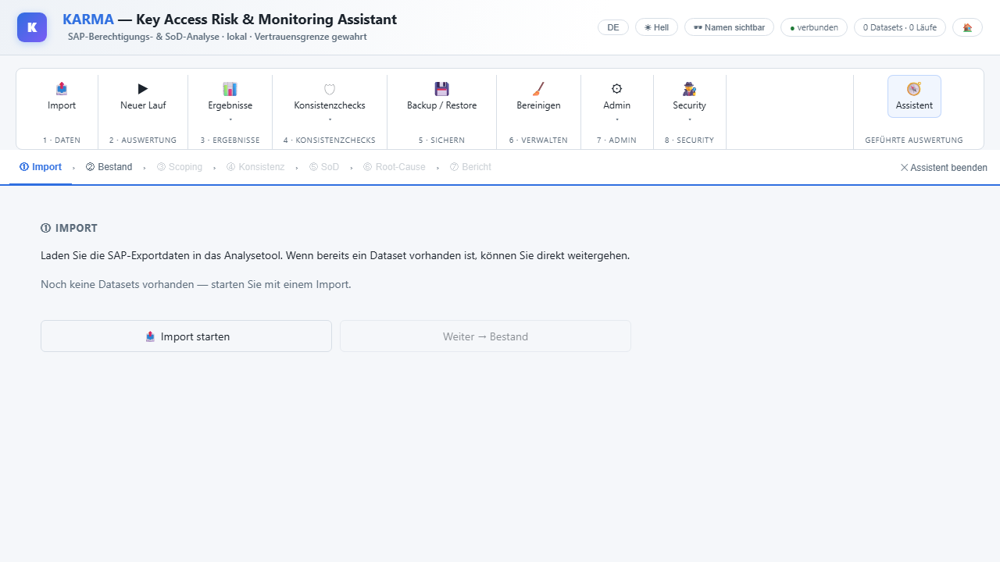
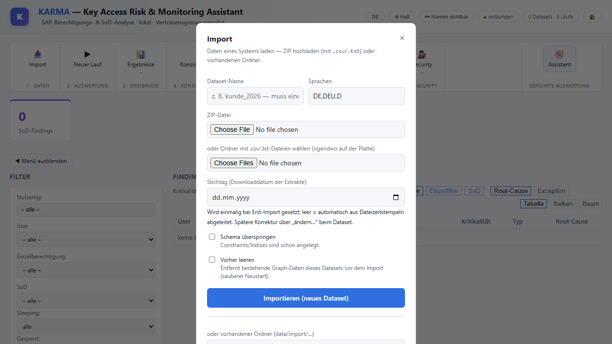
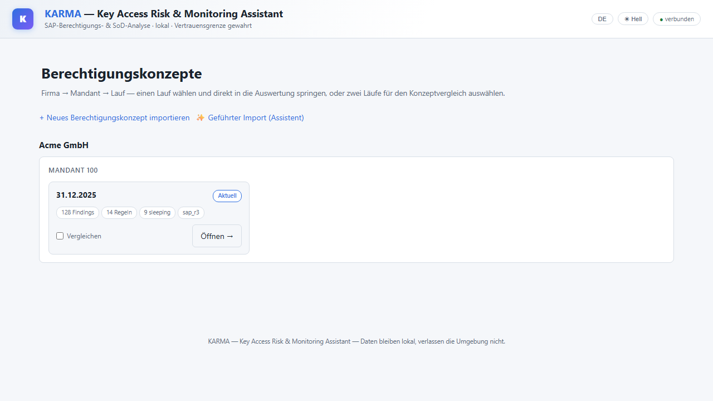

# Installation

Diese Anleitung führt von einem leeren Windows-Rechner bis zur laufenden App und zum ersten Import. Es gibt
**zwei Wege**; welcher passt, hängt davon ab, ob auf dem Rechner Docker Desktop erlaubt ist.

## Welche Variante passt?

| | **A · Docker** (Standard) | **B · Native Windows-Installation** (ohne Docker) |
| --- | --- | --- |
| **Für wen** | Eigener Rechner oder Laptop, auf dem Docker Desktop installiert werden darf | Firmenrechner („Drittrechner“), auf denen Docker nicht möglich ist |
| **Was läuft wie** | Neo4j und Backend als Container | Neo4j als Windows-Dienst, Backend als geplante Aufgabe, beides startet mit dem Rechner |
| **Installation** | Befehle in PowerShell | **`install.exe` doppelklicken** — kein PowerShell nötig |
| **Updates** | `git pull` im Projektordner | täglich automatisch, oder per Klick im Fenster „IAM verwalten“ |
| **Verwaltung** | `docker compose` | Fenster „IAM verwalten“ (Desktop-Verknüpfung) |

Beide Varianten liefern dieselbe App unter <http://localhost:8000/>. Was nach einem Update wann wirksam wird,
steht unter [Updates: Was braucht einen Neustart?](updates.md).

## Gemeinsame Voraussetzungen

- **Windows 10 oder 11, 64 Bit.**
- **Genug Arbeitsspeicher.** Neo4j hält die Graphdaten im Speicher; große SAP-Extrakte brauchen viel. Das
  Docker-Setup reserviert standardmäßig 8 GB Heap und 4 GB Seitencache, die native Installation 16 GB Heap und
  8 GB Seitencache (ausgelegt für einen Rechner mit 32 GB RAM). Auf kleineren Rechnern die Werte senken (s. u.).
- **Zugang zum Repository.** Das Repository ist privat. Die Zugangsdaten bzw. der Deploy-Schlüssel kommen vom
  Betreiber.
- **Internetzugang bei der ersten Installation** (Programmpakete und Neo4j werden heruntergeladen).
- **Kein OneDrive-Ordner als Zielort.** Der Installationsordner enthält SAP-Extrakte und Backups, also
  Mandantendaten, die die Maschine nicht verlassen dürfen — ein synchronisierter Ordner würde sie in die Cloud
  hochladen.

---

## Variante A · Docker

**Zusätzlich nötig:** [Docker Desktop](https://www.docker.com/products/docker-desktop/) mit **WSL2-Backend**
und Git.

1. **Repository klonen** und in den Ordner wechseln (PowerShell):

   ```powershell
   git clone https://github.com/neoprehn/iam.git
   cd iam
   ```

2. **Zugangsdaten anlegen.** Die Vorlage kopieren und das Neo4j-Passwort setzen (mindestens 8 Zeichen). Die Datei
   `.env` bleibt lokal und wird nie ins Repository eingecheckt.

   ```powershell
   Copy-Item .env.example .env
   notepad .env
   ```

   In der Datei steht außerdem `IMPORT_LANG`, die Sprache für Texttabellen beim Import (Standard Deutsch).

3. **Starten.** Der erste Start lädt die Images, installiert APOC und baut das Backend — das dauert einige
   Minuten.

   ```powershell
   docker compose up -d --build
   docker compose run --rm migrations
   ```

   Der zweite Befehl legt das Datenbankschema einmalig an (er ist wiederholbar; der erste Import stellt es
   ebenfalls sicher).

4. **Prüfen.** Die App läuft unter <http://localhost:8000/>, der Neo4j-Browser unter <http://localhost:7474/>.

   ```powershell
   docker compose ps          # beide Container sollten "running" bzw. "healthy" zeigen
   docker compose logs backend --tail 50
   ```

---

## Variante B · Native Windows-Installation (ohne Docker)

Diese Variante ist für Rechner gedacht, auf denen niemand eine Entwicklungsumgebung einrichten soll. Alles
Nötige erledigt **`install.exe`**.

### 1 · Paket bereitstellen

Vom Betreiber kommt ein **Ordner (meist als ZIP)** mit `install.exe`, `manage.exe` und den zugehörigen
PowerShell-Skripten. Entpacke ihn an einen **dauerhaften lokalen Ort** (z. B. `C:\iam-setup`, **nicht** unter
OneDrive und nicht in „Downloads“) — die Update-Aufgabe und das Verwaltungsfenster rufen die Dateien später aus
diesem Ordner auf.

### 2 · Zugangsschlüssel ablegen (nur beim allerersten Mal)

Der Programmcode wird aus dem privaten Repository per SSH geladen. Lege dafür den vom Betreiber erhaltenen
**Deploy-Schlüssel** im Ordner `%USERPROFILE%\.ssh\` ab. Beim ersten Zugriff muss die Verbindung zu GitHub
einmal bestätigt werden (`ssh -T git@github.com` in einer Eingabeaufforderung und die Rückfrage mit `yes`
beantworten). Der Rest wird von der Installation automatisch eingerichtet.

### 3 · `install.exe` starten

**Doppelklick auf `install.exe`.** Windows fragt per Sicherheitsabfrage (UAC) nach Administratorrechten —
bestätigen. Ein Rechtsklick „Als Administrator ausführen“ oder eine geöffnete PowerShell sind **nicht** nötig.

### 4 · Zielordner wählen

Es öffnet sich ein **Ordnerauswahl-Dialog**. Die App wird in einem Unterordner `iam` des gewählten Ordners
angelegt; bei „Abbrechen“ gilt der Standard `C:\iam`.

:::{admonition} Wichtig: nicht unter OneDrive
:class: warning
Liegt der gewählte Pfad erkennbar unter OneDrive, fragt die Installation ausdrücklich nach. Die Vorgabe ist
**„Nein“** — bitte dabei bleiben und einen einfachen lokalen Pfad wie `C:\iam` oder `D:\iam` wählen. Der
Installationsordner enthält später SAP-Extrakte und Backups.
:::

### 5 · Die Installation läuft

Ein Konsolenfenster zeigt den Fortschritt in **acht Schritten**:

| Schritt | Was passiert |
| --- | --- |
| 1 · Voraussetzungen | Git und Python werden gesucht; fehlen sie, installiert `winget` Git bzw. Python 3.12 nach. Java 17 oder neuer wird geprüft; ist das vorhandene Java zu alt, bleibt es für andere Programme unverändert und Neo4j nutzt ein zusätzlich installiertes Java 21. |
| 2 · Repository | Der Programmcode wird in den Zielordner geladen (nur die für den Betrieb nötigen Teile). |
| 3 · `.env` | Eine Zugangsdatei mit **zufällig erzeugtem** Neo4j-Passwort wird angelegt. |
| 4 · Python | Eine eigene Python-Umgebung mit den benötigten Paketen wird angelegt. |
| 5 · Neo4j | Neo4j Community wird heruntergeladen, konfiguriert (Speicher, APOC) und als **Windows-Dienst** gestartet. Das kann beim ersten Start eine Minute dauern. |
| 6 · Backend | Das Backend wird als geplante Aufgabe eingerichtet; es startet bei jedem Systemstart, auch ohne Anmeldung. |
| 7 · Update-Aufgabe | Eine tägliche Aufgabe um 06:00 Uhr holt neuen Programmcode und startet das Backend neu. |
| 8 · Verwaltungsfenster | Eine Desktop-Verknüpfung **„IAM verwalten“** wird angelegt. |

Am Ende bleibt das Fenster **offen** und wartet auf Enter — Erfolgs- und Fehlermeldungen bleiben so lesbar.
Die Installation ist **wiederholbar**: Nach einem Fehler einfach erneut starten, bereits erledigte Schritte
werden übersprungen.

### 6 · Prüfen

Nach der Installation sind erreichbar:

- die **App**: <http://localhost:8000/>
- der **Neo4j-Browser**: <http://localhost:7474/>

Über die Desktop-Verknüpfung **„IAM verwalten“** (Fenster mit Start, Stop, „Neu starten“, „Jetzt
aktualisieren“, „Web-App öffnen“ und den Protokollen) lässt sich der Zustand jederzeit ansehen.

### 7 · Einmalig verifizieren

Die Regelwerke liest Neo4j über einen festen Pfad, den die Installation per Verzeichnisverknüpfung herstellt.
Das ist die einzige nicht selbstverständliche Annahme dieses Setups — bitte direkt nach der Installation im
Fenster **„IAM verwalten“** auf **„Verifizieren (Rulesets)“** klicken (oder den Befehl aus dem Abschnitt
„Verifizieren“ der [Windows-Seite](../technik/windows-native.md) ausführen), **bevor** ein Regelwerk geladen
oder ein Lauf gestartet wird.

### Wenig Arbeitsspeicher?

Die Standardwerte (16 GB Heap, 8 GB Seitencache) sind für eine Maschine mit 32 GB RAM ausgelegt. Auf kleineren
oder stark ausgelasteten Rechnern die Werte im Fenster „IAM verwalten“ über **„Speicher setzen + Neo4j neu
starten“** verringern — oder die Installation mit eigenen Werten starten (PowerShell als Administrator, im
Ordner des Pakets): `.\install.ps1 -HeapSizeGb 4 -PageCacheGb 4`. Ein erneuter Aufruf **ohne** Parameter
ändert an einer bestehenden Installation nichts.

---

## Nach der Installation: erste Schritte

### Startseite

Die Startseite unter <http://localhost:8000/> zeigt noch keine Berechtigungskonzepte. Von hier aus startet der
erste Import.


*Startseite einer frisch installierten App. Die Bildschirmfotos dieser Seite zeigen Beispieldaten.*

### Daten bereitstellen

Die App wertet **SAP-Extrakte** (SE16-Downloads) aus. Welche Tabellen mit welchen Feldern benötigt werden und wie
man sie erzeugt, steht im [Extraktionsleitfaden](../extraktionsleitfaden.md). Die Dateien bleiben lokal und
verlassen den Rechner nie.

### Import

Es gibt zwei Einstiege: **„✨ Geführter Import (Assistent)“** führt Schritt für Schritt durch die ganze
Auswertung und beginnt mit dem Import; **„+ Neues Berechtigungskonzept importieren“** öffnet direkt das
Importformular.



*Der Assistent beginnt mit dem Import. Über „Import starten“ öffnet sich das Formular.*

Im Importformular:



- **Dataset-Name** — ein **Pflichtfeld**. Der Name legt fest, in welches Berechtigungskonzept importiert wird;
  ein bereits vorhandener Name würde in dieses Konzept hinein importieren statt ein neues anzulegen (die App
  fragt in diesem Fall ausdrücklich nach).
- **ZIP-Datei** oder **Ordner** mit den `.txt`-/`.csv`-Dateien der SAP-Extrakte.
- **Stichtag** — das Downloaddatum der Extrakte. Bleibt das Feld leer, wird es aus den Dateizeitstempeln
  abgeleitet; eine spätere Korrektur ist möglich.
- **Sprachen** — Standard `DE,DEU,D` für deutschsprachige Texte.

Nach dem Import und der ersten Auswertung erscheint das Konzept als Karte auf der Startseite — mit Stichtag,
Zahl der Findings und Regeln. Von dort führt **„Öffnen“** in die Auswertung.



*Beispielkarte eines Datasets mit einem Lauf.*

Wie es weitergeht (Auswertung starten, Ergebnisse lesen, Konsistenzchecks, Sichern), beschreibt der
[Workflow](workflow.md); die einzelnen Funktionen sind in der [Funktionsreferenz](funktionen.md) erklärt.

---

## Wenn etwas nicht klappt

| Symptom | Was prüfen |
| --- | --- |
| Die Seite unter `localhost:8000` lädt nicht | **Docker:** `docker compose ps` — läuft das Backend? Protokoll: `docker compose logs backend`. **Nativ:** Im Fenster „IAM verwalten“ den Status ansehen; steht dort „Backend: NICHT aktiv“, auf **„Start“** klicken und mit **„Backend-Log anzeigen“** nach der Ursache suchen. |
| Das Backend startet nicht und meldet einen Importfehler | Es fehlt ein Python-Paket oder eine Datei, meist nach einem Update. **Docker:** `docker compose up -d --build`. **Nativ:** „Jetzt aktualisieren“ (s. [Updates](updates.md)). |
| Neo4j startet nicht oder antwortet nicht | **Docker:** `docker compose logs neo4j`. **Nativ:** „Neo4j-Log anzeigen“ im Verwaltungsfenster; beim allerersten Start kann der Dienst bis zu einer Minute brauchen. |
| Import bricht mit einem Speicherfehler (`OutOfMemory`) ab | Dem Neo4j mehr Speicher geben (Docker: Werte in `docker-compose.yml`; nativ: „Speicher setzen + Neo4j neu starten“). Der Import ist fortsetzbar. |
| Bei der nativen Installation: „Deploy-Schlüssel nicht gefunden“ oder „Host key verification failed“ | Schlüssel in `%USERPROFILE%\.ssh\` ablegen und die Verbindung zu GitHub einmal mit `ssh -T git@github.com` bestätigen, dann `install.exe` erneut starten. |
| Fehlermeldung beim Ändern oder Laden eines Regelwerks | Den Schritt „Verifizieren“ (oben) ausführen. |

Weitere Details, Deinstallation und Verwaltung der Windows-Installation:
[Native Windows-Installation](../technik/windows-native.md).
