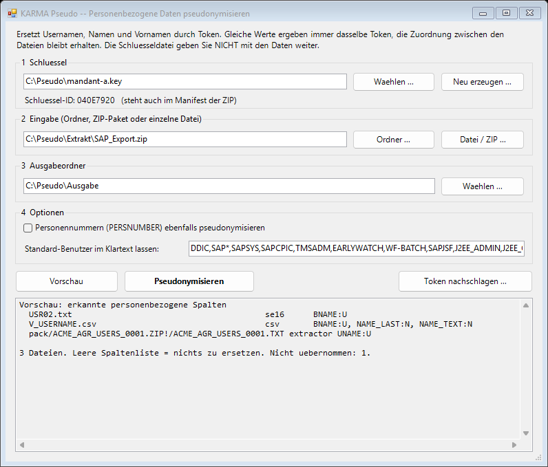
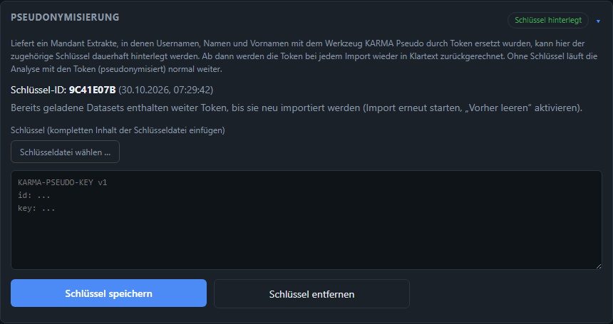

# Pseudonymisierung personenbezogener Daten

Manche Mandanten geben Extrakte nur heraus, wenn **Usernamen, Namen und Vornamen** nicht im Klartext enthalten sind. Für Testdaten gilt dasselbe.
Dafür gibt es das eigenständige Werkzeug **KARMA Pseudo** (Ordner `pseudo/` im Repository). Es ersetzt die personenbezogenen Spalten durch
Token und läuft rein lokal ohne Netzwerkzugriff, kann also dem Mandanten übergeben werden. KARMA selbst entschlüsselt die Token wieder,
sobald der zugehörige Schlüssel hinterlegt ist.

## Ablauf auf einen Blick

1. **Schlüssel erzeugen** (einmal je Mandant) — in KARMA Pseudo *Neu erzeugen …*. Es entsteht eine kleine Datei `….key`.
2. **Extrakte pseudonymisieren** — Eingabe wählen (Ordner, KAAP-Paket als ZIP oder einzelne Datei), Ausgabeordner wählen, **Vorschau** prüfen,
   **Pseudonymisieren**. Ergebnis: `pseudonymisiert-<Datum>.zip` und ein Prüfbericht.
3. **Weitergeben** — nur die ZIP geht an den Empfänger. Die Schlüsseldatei bleibt beim Mandanten bzw. wird **getrennt** und über einen
   anderen Kanal übergeben. Der Prüfbericht ist nur für den Ersteller.
4. **Importieren** — die ZIP wie jeden anderen Extrakt in KARMA importieren. Ohne Schlüssel arbeitet KARMA mit den Token (pseudonymisiert).
5. **Schlüssel hinterlegen** (optional, dauerhaft) — *Management → Konfiguration → Pseudonymisierung*. Ab dem nächsten Import
   werden die Token zu Klartext zurückgerechnet.

*Die Pfade im Bild sind Beispiele. Das Werkzeug gibt es nur auf Deutsch.*

## Was wird ersetzt

| Klasse | Spalten (Beispiele) | Token beginnt mit |
|---|---|---|
| Username | `BNAME`, `UNAME`, `CREATE_USR`, `CHANGE_USR`, `USERNAME`, `MODBE`, `ANAME`, `REFUSER`, `USERALIAS` | `ZU` |
| Name / Vorname | `NAME_LAST`, `NAME_FIRST`, `NAME_TEXT`, `MC_NAMELAS`, `MC_NAMEFIR` | `ZN` |
| Personennummer (optional) | `PERSNUMBER` | `ZP` |

- Die Zuordnung zwischen den Dateien **bleibt erhalten**: derselbe Username ergibt in `USR02`, `AGR_USERS`, `UST04` usw. dasselbe Token.
  Groß-/Kleinschreibung und Leerzeichen am Rand spielen bei Usernamen keine Rolle.
- **Standard-Benutzer bleiben im Klartext** (`DDIC`, `SAP*`, `TMSADM`, `EARLYWATCH` …), weil Regeln und Auswertungen technische Benutzer am
  Namen erkennen. Die Liste ist im Fenster änderbar.
- Die Personennummer wird nur auf Wunsch ersetzt (Haken im Fenster); sie ist eine interne Nummer, aber als Verbindung zwischen
  `V_USERNAME` und `ADRP` relevant.
- Weitere Spalten lassen sich in der Tabelle `$ColClass` am Anfang von `karma-pseudo.ps1` ergänzen. Die **Vorschau** zeigt je Datei, welche Spalten
  erkannt wurden.

Eingaben: SE16-Listenexport (`.txt`), CSV/TSV und KAAP-Extraktor-Pakete (ZIP mit inneren ZIP je Tabelle; die Struktur bleibt erhalten).
Dateien, die keine Datentabellen sind (Protokolle, Bilder, XML des Extraktors), werden nicht übernommen.

## Das Token

`ZU` + Base32 aus Tag und Chiffretext, nur Großbuchstaben und die Ziffern 2–7, z. B. `ZUBCYA5IM5RWABSVFW3HE64` für einen 7-stelligen Username.
Ein typischer Username ergibt 25–31 Zeichen; Namen sind entsprechend ihrer Länge etwas länger. Verfahren „KP1“: HMAC-SHA256-Tag (6 Byte) über
Klasse und Klartext, dazu AES-256-CTR mit dem Tag als Nonce. Das ist **deterministisch** (nötig, damit die Zuordnung erhalten bleibt) und
**umkehrbar** mit dem Schlüssel; der Tag dient zugleich als Echtheitsprüfung. Es ist bewusst keine Verschlüsselung für höchste Ansprüche:
gleiche Werte sind gleich erkennbar (Häufigkeiten), und die Länge des Klartexts ist ablesbar.

## Prüfbericht und Grenzen

Der Prüfbericht (`pruefbericht-<Datum>.txt`, **nicht** in der ZIP) enthält je Datei die erkannten Spalten und Zähler. Außerdem sucht er in allen
anderen Spalten nach **Klartext-Treffern**: Steht ein Username oder Name als Wort in einem Rollennamen oder Text (z. B. `Z_HR_MUELLER`), wird die
Spalte mit Zeilennummern gemeldet — ohne die Werte zu nennen. Diese Spalten werden **nicht** automatisch verändert; die Treffer sind vor der
Weitergabe zu prüfen (ein Treffer kann auch ein harmloses Wort sein).

Nicht erfasst sind Freitext sowie Firmen- und Mandantenbezeichnungen (z. B. der Text des Mandanten in `T000`). Wer diese Angaben ebenfalls
verbergen muss, ersetzt sie vorher von Hand.

## Schlüssel in KARMA hinterlegen

*Management → Konfiguration → Pseudonymisierung*: Schlüsseldatei wählen (oder Inhalt einfügen) und **Schlüssel speichern**. KARMA zeigt danach nur
die **Schlüssel-ID**, nie den Schlüssel selbst. Er liegt in `config/pseudo.key` (per `.gitignore` nicht im Repository).

- **Beim Import** ersetzt KARMA die Token in den konvertierten `.csv` durch Klartext (Schritt „Pseudonyme entschlüsseln“); das gilt auch für
  direkt gelieferte `.csv`. Dateien ohne Token bleiben unberührt, der Schritt ist wiederholbar.
- **Bereits geladene Datasets** enthalten weiter Token, bis sie neu importiert werden (*Vorher leeren* aktivieren). Der Graph wird bewusst nicht
  nachträglich umgeschrieben, weil Usernamen Teil der Knoten-Schlüssel sind.
- **Schlüssel ersetzen**: nur nach Bestätigung; Daten, die mit dem bisherigen Schlüssel pseudonymisiert wurden, lassen sich danach nicht mehr
  entschlüsseln. **Schlüssel entfernen**: neue Importe bleiben pseudonymisiert, bereits entschlüsselte Daten im Graphen bleiben.
- Nach dem Speichern die Schlüsseldatei **löschen** (Downloads-Ordner, Papierkorb, Übergabemedien). KARMA weist darauf hin.
- Ein **verlorener Schlüssel** lässt sich nicht ersetzen: Die Pseudonyme sind dann nicht mehr zurückzurechnen. Den Schlüssel deshalb wie ein
  Passwort sichern.
- Einzelne Token lassen sich mit *Token nachschlagen …* im Werkzeug auflösen (Kommandozeile: `-Action lookup`).

Ab dem Zeitpunkt, an dem ein Schlüssel hinterlegt ist, steht in KARMA Klartext im Graphen. Für Mandanten, die das nicht wollen, bleibt der Betrieb
ohne Schlüssel voll nutzbar — dann sieht man in den Auswertungen die Token statt der Namen.
