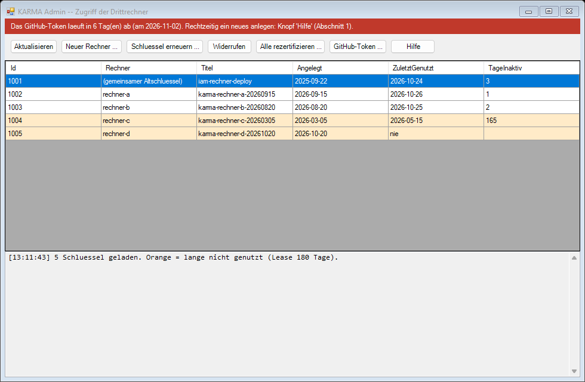
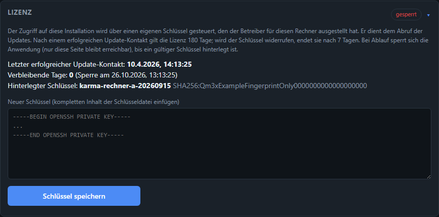

# Native Windows-Installation (ohne Docker)

Der Standardpfad ist **container-only** über Docker Desktop/WSL2 (s. [Architektur](architektur.md)
und die Haupt-`README.md`). Für genau einen Fall gibt es eine bewusste, zusätzliche Abweichung
davon: einen Drittrechner, auf dem Docker Desktop nicht installiert werden darf oder kann, die
einzelnen Komponenten (Python, Java, Neo4j) aber schon. Skripte, vollständige Anleitung und
Troubleshooting liegen im Repo unter [`deploy/windows-native/`][repo-deploy] — diese Seite
beschreibt Zweck, Ablauf und die Vertrauensgrenze dafür.

[repo-deploy]: https://github.com/neoprehn/iam/tree/main/deploy/windows-native

## Was entsteht

- **Neo4j Community Server** als native Windows-Dienst (kein Container) — Speicher-/APOC-/
  Import-Einstellungen sind 1:1 aus `docker-compose.yml` übernommen, damit sich Docker- und
  native Installation fachlich identisch verhalten.
- **Backend** (`uvicorn`) als Scheduled Task, der bei jedem Systemstart automatisch läuft, auch
  ohne Login — funktional das Windows-Äquivalent zum `iam-backend`-Container.
- Ein **täglicher Update-Task**: `git fetch` + `merge --ff-only`, Python-Abhängigkeiten
  synchronisieren, Backend neu starten. Bewusst ein einfacher Pull statt eines echten
  CI/CD-Build-Servers — kein zusätzlicher Betriebsaufwand, Code kommt unverändert aus dem
  Git-Repo. Bricht ab (statt zu überschreiben), wenn der lokale Stand nicht per Fast-Forward
  aktualisierbar ist.
- Ein kleines **Management-Fenster** ("IAM verwalten", Desktop-Verknüpfung) für Start/Stop/
  Neustart, "Jetzt aktualisieren", Web-App öffnen, Update-/Neo4j-Log ansehen und einen
  Verifizieren-Klick — ohne PowerShell bedienen zu müssen.
- Beide Einstiegspunkte (Installer, Management-Fenster) gibt es auch als eigenständige `.exe`
  (`ps2exe`, `-requireAdmin`-Manifest) — kein manuelles PowerShell-Fenster, keine Datei-
  Zuordnungs-Stolpersteine bei Doppelklick.

Das Paket (`install.ps1`, `manage.ps1`, `update.ps1`, `start-backend.ps1`, `build-exe.ps1`) ist
eigenständig lauffähig: `install.ps1` klont die App selbst per `git clone`. Ein vorheriger
vollständiger Checkout ist nicht nötig — der Ordner reicht, z. B. als ZIP an den Drittrechner
verschickt.

## Installation

**Empfohlen:** `install.exe` doppelklicken — fordert Adminrechte automatisch per UAC-Dialog an.
Alternative für automatisierte Läufe oder wenn nur die `.ps1`-Dateien vorliegen, als Administrator:

```powershell
.\install.ps1
```

Ohne `-InstallDir` öffnet sich ein Ordnerauswahl-Dialog für den Zielort (Abbrechen verwendet den
Standard `C:\iam`). Das Skript ist idempotent — mehrfaches Ausführen überspringt bereits erledigte
Schritte.

:::{admonition} Vertrauensgrenze: Zielordner nicht unter OneDrive wählen
:class: important

Der gewählte Zielordner enthält SAP-Extrakte, Backups und Zugangsdaten — also echte
Mandantendaten (s. u., "Wo liegen die Daten?"). Ein OneDrive-synchronisierter Pfad würde diese
automatisch in die Microsoft-Cloud hochladen — das ist kein Performance-Detail, sondern verletzt
die Vertrauensgrenze dieses Projekts (Mandantendaten verlassen die lokale Maschine nie).
`install.ps1` erkennt einen OneDrive-Pfad automatisch und fragt vor der Installation explizit
nach; Standard-Antwort ist "Nein". Empfehlung: ein einfacher lokaler Pfad wie `C:\iam`.
:::

Direkt nach der Installation den **Verifizieren-Schritt** durchgehen (README, Abschnitt
"Verifizieren"): Die Ruleset-Dateien unter `rules/` liest Neo4j über einen festen Pfad
(`apoc.load.json('file:///rules/...')`, identisch zum Docker-Bind-Mount), den `install.ps1` ohne
Container über eine NTFS-Junction nachbildet. Das ist die einzige nicht-triviale Annahme in diesem
Setup und lässt sich mit einem einzelnen `cypher-shell`-Befehl direkt gegentesten.

## Wo liegen die Daten?

Alles, was pro Installation lokal entsteht, hängt an **einem** Ort — dem gewählten Zielordner
(`$InstallDir`, Standard `C:\iam`):

| Was | Wo | Im Git? |
|---|---|---|
| SAP-Extrakte (Rohdaten) | `<InstallDir>\data\import` | Nein (gitignored) |
| Backups (Dataset-/Lauf-Zips) | `<InstallDir>\backups` | Nein (gitignored) |
| Zugangsdaten (`NEO4J_PASSWORD`) | `<InstallDir>\.env` | Nein (gitignored) |
| App-Code (Backend/Frontend/Cypher/Regeln) | `<InstallDir>\...` | Ja |

Die **Neo4j-Datenbank selbst** liegt bewusst außerhalb von `$InstallDir`, direkt unter der
Laufwerkswurzel (`<Laufwerk>:\neo4j\neo4j-community-<Version>\...`) — technisch wegen der
rules-Junction, praktisch aber auch ein zusätzlicher Schutz: Selbst wenn `$InstallDir` versehentlich
in einem synchronisierten Ordner läge, bliebe die Datenbank davon unberührt.

## Updates

Automatisch täglich (Scheduled Task `IAM-Update`) oder manuell per Klick im Management-Fenster.
Ein Update-Lauf rührt **nur den Code** an — `data/`, `backups/` und `.env` bleiben unangetastet,
Neo4j selbst (Version, Speicher-/APOC-Konfiguration) wird nicht automatisch aktualisiert, genau
wie eine Docker-Compose-Änderung dort auch kein automatisches Update auslöst.

**Was nach einem Update wann wirksam wird** — und warum der Knopf „Code aktualisieren (Git Pull)“ nicht
alles erledigt — steht im Benutzerhandbuch unter [Updates: Was braucht einen Neustart?](../handbuch/updates.md).

## Zugriff steuern: Schlüssel, Lizenz, Widerruf, Rezertifizierung

Der Zugriff eines Drittrechners auf KARMA hängt an **seinem eigenen Schlüssel** (ein nur lesender GitHub-Deploy-Key). Der
Betreiber stellt ihn aus, kann ihn **einzeln widerrufen** und kann **alle Rechner neu zertifizieren** — das läuft über die
separate Anwendung **KARMA Admin** (`admin/karma-admin.exe`, Beschreibung in `admin/README.md`), nicht über die KARMA-App.

**Fristen.** Jeder erfolgreiche Update-Kontakt (täglicher Update-Lauf oder Knopf „Code aktualisieren“) verlängert die Lizenz
auf **180 Tage**. Wird der Zugriff verweigert (Schlüssel widerrufen), verkürzt sich die Frist auf **7 Tage** nach dem ersten
verweigerten Zugriff. Danach **sperrt sich die Anwendung**: Alle Seiten leiten auf *Management → Konfiguration → Lizenz* um,
nur dort lässt sich ein neuer Schlüssel hinterlegen. Ab 30 Tagen Restlaufzeit bzw. nach einem erkannten Widerruf zeigt die
Startseite einen Hinweisbalken. Netzwerkprobleme und Konfigurationsfehler (z. B. unbekannter Host-Key) zählen **nicht** als
Widerruf. Das ist eine organisatorische Steuerung auf dem Rechner des Anwenders, kein Kopierschutz.

**Was ein Widerruf bewirkt — und was nicht.** Er beendet die Updates für diesen Rechner und löst nach 7 Tagen die Sperre aus;
die bereits installierte Anwendung läuft bis dahin weiter. Er entfernt nichts vom Rechner.

### Ablauf auf einen Blick

**Einmalig (Betreiber)**

1. GitHub-Token anlegen (Schritt für Schritt unten, Abschnitt „GitHub-Token der Admin-Anwendung“) und in KARMA Admin eintragen.

**Für jeden Drittrechner**

2. In KARMA Admin **Neuer Rechner …** — Name eintragen (z. B. der Name des Kollegen), Übergabeordner wählen. Ergebnis: ein Eintrag in der
   Liste und die Datei `karma-<name>-<Datum>.key`.
3. Die `.key`-Datei **über einen sicheren Kanal** an den Empfänger geben (nicht unverschlüsselt per Mail). Sie ist der Zugang zum Code.
4. Empfänger hinterlegt den Schlüssel: bei einer **neuen Installation** neben `install.exe` legen, bei einer **bestehenden** unter
   *Management → Konfiguration → Lizenz* einfügen. Danach die Datei beim Empfänger löschen.
5. Kontrolle in KARMA Admin (**Aktualisieren**): sobald der Rechner Updates geholt hat, steht bei dem Schlüssel ein Datum unter
   *ZuletztGenutzt*.

**Laufend**

6. Jeder erfolgreiche Update-Kontakt des Rechners setzt dessen Lizenz auf 180 Tage zurück — der Anwender muss nichts tun.
   Urlaub oder ein ausgeschalteter Rechner sind unkritisch.
7. KARMA Admin warnt **10 Tage vor Ablauf des GitHub-Tokens**; dann ein neues Token anlegen (Abschnitt unten, auch unter **Hilfe**).

**Bei Bedarf**

8. *Rotation* (turnusmäßig oder bei Verlust), *Widerruf* (Kollege scheidet aus) oder *Rezertifizierung aller Rechner* — siehe die Abschnitte
   weiter unten. Ein Widerruf wird nicht an den Rechner gesendet; er merkt ihn beim nächsten Update-Lauf, ab dann laufen 7 Tage.



*Orange Zeilen: Schlüssel, die lange oder nie genutzt wurden. Die rote Leiste erscheint 10 Tage vor Ablauf des Tokens. Alle Namen im Bild sind Beispiele.*

**Was der Anwender sieht**

- Lizenz in Ordnung: *Management → Konfiguration → Lizenz* zeigt den letzten Kontakt, die verbleibenden Tage und den hinterlegten Schlüssel.

  

- Nach einem Widerruf bzw. ab 30 Tagen Restlaufzeit erscheint oben ein Hinweis mit der Restzeit:

  

- Nach Fristablauf ist nur noch die Lizenz-Seite erreichbar, dort wird ein neuer Schlüssel eingefügt und mit **Schlüssel speichern** geprüft:

  

### Rechner anlegen

1. In KARMA Admin **Neuer Rechner …**, Namen eintragen (z. B. `rechner-a`) und einen Ordner für die Übergabe wählen.
   Erzeugt wird ein eigenes Schlüsselpaar; der öffentliche Teil wird als nur lesender Deploy-Key mit dem Titel
   `karma-<rechner>-<Datum>` bei GitHub eingetragen, der private Teil liegt als `karma-<rechner>-<Datum>.key` (plus
   `…-uebergabe.txt`) im gewählten Ordner.
2. **Neue Installation:** die `.key`-Datei neben `install.exe` legen und `install.exe` ausführen — der Installer übernimmt sie
   (geschützt unter `C:\ProgramData\iam\ssh`).
3. **Bestehende Installation:** den Dateiinhalt in KARMA unter *Management → Konfiguration → Lizenz* einfügen und
   **Schlüssel speichern**. Die Seite prüft den Schlüssel gegen GitHub und setzt die Laufzeit zurück. Danach die `.key`-Datei
   beim Empfänger löschen.

### Schlüssel rotieren (z. B. Verdacht auf Verlust, turnusmäßig)

1. In KARMA Admin den Rechner markieren und **Schlüssel erneuern …** — es entsteht ein **zusätzlicher** neuer Schlüssel, der alte
   bleibt zunächst aktiv (kein Ausfall).
2. Neuen Schlüssel wie oben auf dem Rechner hinterlegen (Seite *Lizenz*).
3. In der Liste prüfen, dass der **neue** Schlüssel als „zuletzt genutzt“ erscheint, dann den **alten** per **Widerrufen** entfernen.

### Zugriff entziehen

In KARMA Admin den Schlüssel des Rechners markieren und **Widerrufen**. Der Rechner erhält keine Updates mehr; sein nächster
Update-Lauf meldet „Zugriff verweigert“, die Frist beträgt ab dann 7 Tage. Die Liste zeigt je Schlüssel, wann er zuletzt genutzt
wurde — Schlüssel ohne Kontakt über längere Zeit sind orange markiert (die Lizenz läuft nach 180 Tagen ohne Kontakt ohnehin ab).

### Alle Rechner rezertifizieren

**Alle rezertifizieren …** stellt für jeden verwalteten Rechner einen neuen Schlüssel aus und **widerruft anschließend alle bisherigen**
(auch den früheren gemeinsamen Schlüssel `iam-rechner-deploy`). Die neuen Schlüsseldateien werden an die Rechner übergeben und dort
unter *Lizenz* hinterlegt; Rechner, bei denen das binnen 7 Tagen ausbleibt, sperren sich. Ein Probelauf ist auf der Kommandozeile
möglich (`karma-admin.ps1 -Action recertify -OutDir <Ordner> -DryRun`).

### GitHub-Token der Admin-Anwendung

KARMA Admin braucht ein GitHub-Token: *fine-grained*, nur für dieses Repository, Berechtigung **Administration: Read and write**
(Deploy-Keys verwalten). GitHub kennt für Deploy-Keys keine kleinere Berechtigung; sie umfasst auch Repository-Einstellungen und
Mitarbeiter — deshalb nur für dieses eine Repository und mit kurzer Laufzeit (empfohlen: 90 Tage).

**Token anlegen oder erneuern — Schritt für Schritt** (derselbe Text steht in KARMA Admin unter **Hilfe**):

1. Bei GitHub anmelden (Konto mit Administratorrechten auf dem Repository).
2. Profilbild → *Settings* → ganz unten *Developer settings* → *Personal access tokens* → *Fine-grained tokens* → *Generate new token*.
3. *Token name*: z. B. `karma-admin`. *Expiration*: 90 days.
4. *Repository access*: *Only select repositories* → nur dieses Repository wählen.
5. *Permissions → Repository permissions → Administration*: **Read and write**. Alle anderen Berechtigungen bleiben auf *No access*.
6. *Generate token*. Das Token beginnt mit `github_pat_` und wird nur **einmal** angezeigt — kopieren.
7. In KARMA Admin **GitHub-Token …** klicken, das Token einfügen, OK.
8. Das alte Token bei GitHub löschen (falls nicht ohnehin abgelaufen).


**Ablauf des Tokens.** Die Anwendung liest das Ablaufdatum bei jedem GitHub-Aufruf und zeigt **10 Tage vorher** (und danach) eine rote
Leiste und eine Meldung beim Start. Ein abgelaufenes Token betrifft nur KARMA Admin — die Drittrechner arbeiten unverändert weiter.
Notfalls lässt sich ein Schlüssel auch ohne Token direkt bei GitHub entfernen (*Repository → Settings → Deploy keys → Delete*).
**Aufbewahrung.** Das Token wird mit der Windows-Benutzerverschlüsselung im eigenen Profil abgelegt (nie im Repo, nie in der `.exe`).
Wer die Admin-Anwendung weitergibt, gibt damit **kein** Token weiter — jeder Nutzer trägt sein eigenes ein.


## Details, Troubleshooting, Deinstallation

Vollständig in [`deploy/windows-native/README.md`][repo-deploy] im Repo — u. a. Verwaltung über
die Kommandozeile als Alternative zum Management-Fenster, Umgang mit einem fehlgeschlagenen
Fast-Forward-Update, Speicher-Tuning und Deinstallation.
